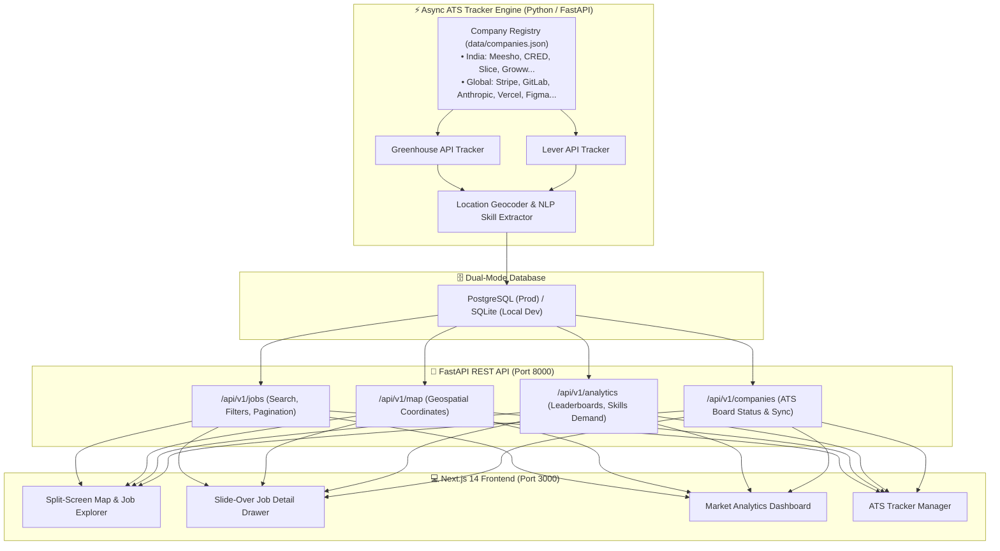

# 🔍 JobLens 2.0 — Geospatial Labor Market Intelligence Platform

<div align="center">


**An enterprise labor market intelligence platform that monitors live corporate applicant tracking systems (Greenhouse & Lever) across India and Global tech ecosystems, geocodes hiring demand, and visualizes market concentration with an interactive Next.js map dashboard.**

[](https://nextjs.org) [](https://fastapi.tiangolo.com) [](https://postgresql.org) [](https://typescriptlang.org) [](https://tailwindcss.com)

</div>

---

## 🚀 Key Features

* **⚡ Direct ATS Multi-Company Ingestion**: Ingests directly from official Greenhouse and Lever API feeds (Meesho, CRED, Slice, Groww, Stripe, GitLab, Figma, Anthropic, Scale AI, Vercel, Airbnb, Coinbase, Datadog, etc.) — 0% ghost jobs, 0% dead links, no API keys required.
* **🗺️ Synchronized Geospatial Map**: Interactive visual map with equirectangular mercator projections, city cluster bubbles, and heat intensity rings.
* **🎛️ Real-Time Split-View Explorer**: Left-hand filterable job feed with right-hand map sync, keyword search, role categorization chips, and remote filter.
* **📄 Slide-Over Job Detail Drawer**: Reads complete job specs, qualifications, and extracted tech stacks without page reloads, with a direct "Apply on Official Site" button.
* **📊 Market Analytics Dashboard**: Real-time hiring volume leaderboards, in-demand technical skills index, and regional tech hub concentration charts.
* **🏢 ATS Company Manager**: Live status dashboard displaying all monitored company boards, active job counts, and 1-click on-demand sync.
* **🗄️ Dual-Mode Database Engine**: Runs on zero-config local SQLite (`joblens.db`) out-of-the-box, with instant switch to production PostgreSQL / PostGIS via `.env`.

---

## 🏗️ System Architecture



---

## 📂 Project Structure

```
JobLens/
├── 📁 backend/
│   ├── 🐍 main.py              # FastAPI REST endpoints & CORS configuration
│   ├── 🗄️ database.py          # SQLAlchemy dual-mode database engine (SQLite/Postgres)
│   ├── 📊 models.py            # Job & Company ORM models
│   ├── 🛠️ utils.py             # Geo & formatting utilities
│   ├── 📁 trackers/            # ATS Ingestion Engine
│   │   ├── base.py             # Abstract BaseTracker
│   │   ├── greenhouse.py       # Greenhouse API parser
│   │   ├── lever.py            # Lever API parser
│   │   └── engine.py           # Async parallel ingestion orchestrator
│   └── 📁 services/
│       ├── geocoder.py         # Location normalizer & coordinate resolver
│       └── extractor.py        # Regex NLP experience & skill extractor
│
├── 📁 frontend/                # Next.js 14 Modern Web Dashboard
│   ├── 📁 app/
│   │   ├── layout.tsx          # Root layout & Header
│   │   ├── page.tsx            # Main Split-Screen Map & Job Feed
│   │   ├── globals.css         # Tailwind & custom animations
│   │   ├── 📁 analytics/       # Market Intelligence Analytics view
│   │   └── 📁 tracker/         # ATS Board sync & company manager
│   ├── 📁 components/
│   │   ├── Header.tsx          # Navigation & live ticker
│   │   ├── InteractiveMap.tsx  # Map canvas with cluster nodes
│   │   ├── JobCard.tsx         # Modern job card
│   │   ├── JobDetailDrawer.tsx # Slide-out job specs viewer
│   │   └── FilterSidebar.tsx   # Multi-faceted search & filter
│   ├── 📁 lib/
│   │   ├── api.ts              # Typed API client
│   │   └── types.ts            # TypeScript interfaces
│   ├── package.json
│   └── tailwind.config.js
│
├── 📁 data/
│   ├── 🏢 companies.json       # Monitored company registry
│   ├── 📋 roles.csv            # Role taxonomy
│   └── 🎯 skills.csv           # Skills taxonomy
│
├── 📁 tests/
│   └── 🧪 test_api.py          # Automated Pytest suite
│
├── ⚙️ .env.example             # Environment configuration template
├── 📦 requirements.txt         # Python dependencies
├── 🚀 run_backend.bat          # 1-Click start FastAPI backend
├── 💻 run_frontend.bat         # 1-Click start Next.js frontend
└── 🔄 sync_ats.bat             # 1-Click sync ATS jobs
```

---

## ⚡ Quick Start

### 1️⃣ Prerequisites
* **Python 3.10+**
* **Node.js 18+** & npm

### 2️⃣ Start Backend (FastAPI)
```powershell
# Double-click run_backend.bat OR run via command line:
cd JobLens
.\venv\Scripts\activate
uvicorn backend.main:app --host 127.0.0.1 --port 8000 --reload
```
* **API running on**: `http://127.0.0.1:8000`
* **Interactive Docs**: `http://127.0.0.1:8000/docs`

### 3️⃣ Start Frontend (Next.js)
```powershell
# Double-click run_frontend.bat OR run via command line:
cd JobLens/frontend
npm run dev
```
* **Web Dashboard**: `http://localhost:3000`

### 4️⃣ Sync Live Jobs (Greenhouse & Lever)
```powershell
# Run the ATS Ingestion Engine anytime to pull fresh postings:
cd JobLens
python -m backend.trackers.engine
```

---

## 🧪 Running Tests

```powershell
python -m pytest tests -v
```

---

## 📄 License
MIT License.
